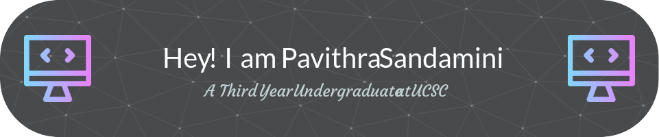

  

  

<h1 align="center">Hi 👋, I'm Pavithra Sandamini</h1>
<h3 align="center">Software Engineer | Full Stack Development | Cloud & DevSecOps | AI Engineering</h3>

  I enjoy building scalable applications, cloud-native platforms, and practical AI-powered solutions.
  I work across frontend and backend development, cloud infrastructure, automation, and DevSecOps.

  🌐 <a href="https://pavithrasandamini.netlify.app/">Portfolio</a> ·
  💼 <a href="https://www.linkedin.com/in/pavithrasandamini/">LinkedIn</a> ·
  ✍️ <a href="https://medium.com/@pavithrasandamini">Medium</a>

👩‍💻 About Me
- 💻 Software Engineer with experience building full-stack and cloud-native applications.
- ☁️ Interested in AWS, serverless architectures, Kubernetes, Infrastructure as Code, and DevSecOps.
- 🤖 Exploring AI engineering, Retrieval-Augmented Generation (RAG), and LLM-powered applications.
- 🔭 Building products and solutions across web development, cloud infrastructure, and automation.
- 📚 B.Sc. in Computer Science – University of Colombo School of Computing.
- 📫 Reach me at gpavithrasandamini@gmail.com.
🤝 Connect With Me

  
  
  
  
  

🛠️ Languages, Frameworks & Tools
<h4 align="center">Programming Languages</h4>

  

<h4 align="center">Frontend Development</h4>

  

  
  
  
  

<h4 align="center">Backend Development & APIs</h4>

  
  
  

<h4 align="center">Cloud & AWS</h4>

  
  
  
  
  
  
  
  
  
  
  

<h4 align="center">Containers, Infrastructure & GitOps</h4>

  
  
  
  
  

<h4 align="center">Monitoring, Observability & Security</h4>

  
  
  
  
  

<h4 align="center">AI Engineering & Data</h4>

  
  
  
  

<h4 align="center">Databases & Testing</h4>

  
  
  
  
  

🚀 Featured Projects
A selection of projects demonstrating my work across AI engineering, serverless application development, event platforms, and cloud-native DevSecOps.
<table>
  <tr>
    <td width="50%" valign="top">
      <h3>🛍️ AI Shopping Assistant</h3>
      
<strong>RAG Chatbot for E-Commerce</strong>

      
An AI-powered shopping assistant that answers customer questions using real product and pricing data.

      <strong>Key contributions</strong>
      <ul>
        <li>Implemented RAG with ChromaDB and the OpenAI API to ground answers in product data.</li>
        <li>Added LLM guardrails to keep responses within approved topics.</li>
        <li>Built a standalone FastAPI microservice and an embeddable storefront chat widget.</li>
      </ul>
      
<strong>Tech stack</strong> Python · FastAPI · OpenAI API · ChromaDB · RAG · Docker · Docker Compose

    </td>
    <td width="50%" valign="top">
      <h3>🏟️ <a href="https://sportizza.com">Sportizza</a></h3>
      
<strong>Sports Arena Booking Platform</strong>

      
A serverless marketplace where players discover arenas, check court availability, and book slots.

      <strong>Key contributions</strong>
      <ul>
        <li>Implemented atomic booking workflows with DynamoDB transactions and conditional writes to prevent double bookings.</li>
        <li>Added distributed tracing and operational alerts with AWS X-Ray, CloudWatch, and SNS.</li>
        <li>Automated infrastructure provisioning and multi-environment deployments.</li>
      </ul>
      
<strong>Tech stack</strong> AWS Lambda · API Gateway · DynamoDB · Cognito · Amplify · CloudWatch · X-Ray · Secrets Manager · AWS CDK · TypeScript · GitHub Actions · Next.js · Sanity

    </td>
  </tr>
  <tr>
    <td width="50%" valign="top">
      <h3>🎟️ Engagi</h3>
      
<strong>QR-Based Event Management</strong>

      
A real-time event registration and check-in platform that supported 1,000+ attendees at the National ICT Conference 2024 and the Association of Professional Bankers.

      <strong>Key contributions</strong>
      <ul>
        <li>Built registration, email confirmation, invitation, and QR-code generation workflows.</li>
        <li>Developed real-time dashboards for 15+ event operators using Cloud Firestore.</li>
      </ul>
      
<strong>Tech stack</strong> React · JavaScript · Firebase Cloud Functions · Cloud Firestore · GitHub Actions

    </td>
    <td width="50%" valign="top">
      <h3>☸️ Cloud-Native DevSecOps Platform</h3>
      
<strong>Three-Tier MERN Application</strong>

      
An end-to-end cloud-native DevSecOps platform built around Infrastructure as Code, CI/CD security checks, and GitOps.

      <strong>Key contributions</strong>
      <ul>
        <li>Provisioned AWS networking and private EKS infrastructure using Terraform.</li>
        <li>Integrated SonarQube quality gates, dependency checks, Trivy image scanning, and Amazon ECR into CI/CD.</li>
        <li>Implemented GitOps deployments with Argo CD and Kubernetes Ingress, with Prometheus and Grafana monitoring.</li>
      </ul>
      
<strong>Tech stack</strong> AWS EKS · Terraform · GitLab CI/CD · Docker · Kubernetes · Argo CD · SonarQube · Trivy · Prometheus · Grafana

    </td>
  </tr>
</table>📊 GitHub Statistics

  
  

  

  Statistics are generated from public GitHub activity and may take time to refresh.

  <i>Thanks for visiting my profile! Feel free to explore my repositories and connect with me.</i>

